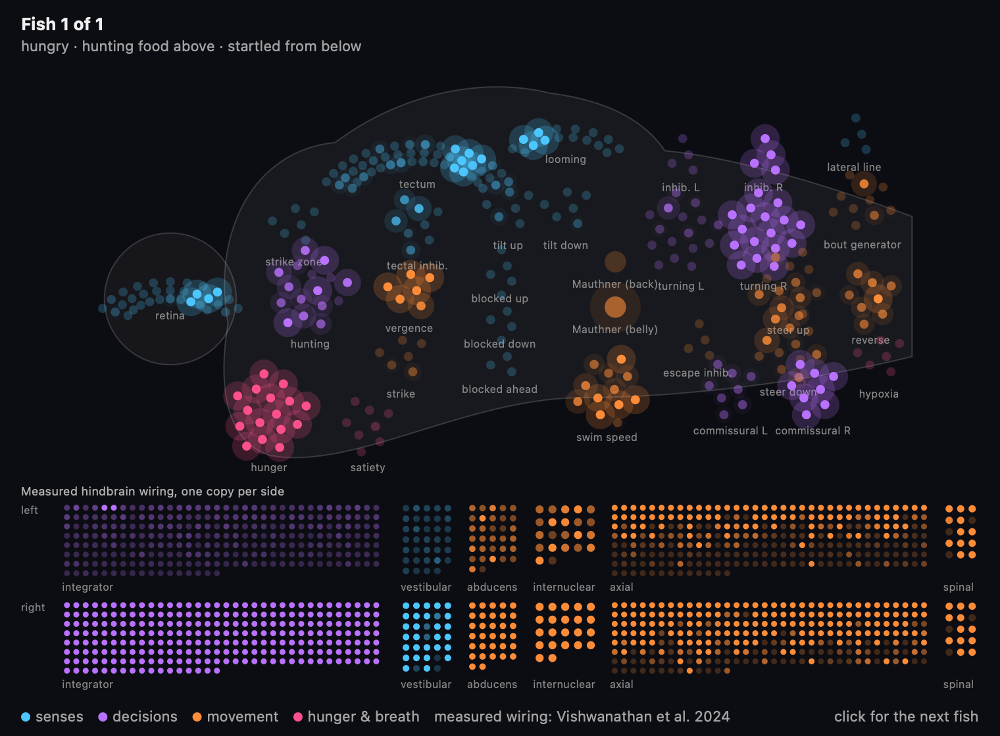

# Fluid Hose

A desktop fluid toy for macOS. Hold **Option** to pour water from a nozzle controlled by the mouse. Water lands on window tops, drips off their edges, and pools at the bottom of the usable desktop, above the Dock. Drag a window through the water and it sloshes; water resting on a window rides along with it. Drop in rubber ducks: they bob on the water, drift with the current, ride on windows, and get batted around when you drag a window into them. Or keep fish: each one has a small spiking brain that hunts the food you sprinkle, darts away when the pointer rushes at it, needs water to breathe, and dies if you forget to feed it.

The overlay uses **AppKit + native Metal**. The fluid is a position-based fluid solver running in Metal compute shaders, and windows are tracked live through WindowServer notifications. The overlay is transparent and lets mouse clicks pass through, so you can move and resize the real windows normally while the simulation runs.

## Run

From the workspace root:

```sh
./examples/fluid-hose/build.sh
./examples/fluid-hose/run.sh
```

Building requires macOS 14 or newer and Apple's C++ compiler. The build also downloads a measured larval zebrafish hindbrain wiring diagram for the fish (31 KB; see [Measured hindbrain](#measured-hindbrain)); without network access the fish still work, with a hand-wired brain only. With full Xcode the build compiles the shaders into `fluid.metallib`; with only the Command Line Tools it bundles the shader source instead, and Metal compiles it when the app launches. Rubber ducks, fish, and fish food use [Jolt Physics](https://github.com/jrouwe/JoltPhysics) v5.6.0 (MIT), pinned as a Git submodule in `third_party/JoltPhysics`. The build fetches the submodule if needed and compiles Jolt once into a cached static library (about 15 seconds); the app bundles Jolt's license as `JoltPhysics-LICENSE.txt`. Otherwise the app links only macOS system frameworks and requires no SDL SDK or third-party runtime library. The shared [devenv environment](../../README.md) provides the repository's development and checking tools; it is optional for building and running the hose itself.

Or open `build/Fluid Hose.app` from this example folder in Finder.

- Move the mouse above a window and **hold Option** to pour. Release it to stop.
- When the pointer is over a solid window body, the nozzle snaps to the nearest available edge.
- Use the **💧 menu-bar icon** to pour continuously, pause, clear the water, or quit.
- Choose a monitor through **💧 → Display**. Names, sizes, and a checkmark identify the active display. Your choice is remembered for the next launch.
- **Option+scroll** while pouring changes the flow, from a slow drip (0.25×) to a strong jet (3×); **💧 → Flow** shows the current rate and offers presets. The nozzle's opening widens and brightens with the flow. With the Accessibility permission (System Settings → Privacy & Security → Accessibility), the scroll is consumed so the window under the pointer does not also scroll; without it, that window scrolls too.
- **💧 → Add rubber duck 🦆** drops a duck from a random point along the top of the screen; **Remove ducks** takes them all away. Clearing the water leaves the ducks. Up to 32 ducks fit.
- **💧 → Add fish 🐟** drops a young adult fish the same way, so pour some water first; it is a female or a male, whichever the pond has fewer of. **Hold Control** to sprinkle food from the pointer, or use **💧 → Feed the fish** to drop a pinch above one. A status line under **Remove fish** says how they are doing: happy, hungry, starving, out of water, or dead. **Show fish brain** opens a window of a fish's neurons firing; click it to watch the next fish. See [Fish](#fish). Up to 16 fish fit.
- **💧 → Liquid** sets how the water moves: **Water** is runny and splashy, **Thick** flows slowly, and **Goo** clings and stretches. It applies to the water already on screen.
- **💧 → Particle size** trades detail for volume. **Fine** gives the most detailed streams and drops; **Coarse** holds the most water. Changing the size clears the water.
- **💧 → Refract the desktop** bends the desktop seen through the water, like a lens. It needs the Screen Recording permission; see [Refraction](#refraction).
- **Use Mac tilt** changes gravity using laptop motion; **Reverse tilt left/right** flips the horizontal direction if needed.
- **Ctrl+C** also quits when launched from Terminal.

For continuous pouring from launch:

```sh
./examples/fluid-hose/run.sh --pour
```

The flow, liquid, particle size, and refraction choices are remembered. The defaults are fine water without refraction. They can also be chosen for a single launch:

```sh
./examples/fluid-hose/run.sh --liquid thick --size coarse
./examples/fluid-hose/run.sh --refraction
./examples/fluid-hose/run.sh --flow 2
./examples/fluid-hose/run.sh --ducks 5
./examples/fluid-hose/run.sh --fish 3 --brain
```

The app has no Dock icon or visible window frame. Its menu-bar icon provides the controls.

Switching displays clears the water and moves the overlay, hose, and window collisions to that display. If the selected monitor disconnects, the app falls back to an available display and returns to the saved monitor when it reconnects. The menu also refreshes when monitors are added, rearranged, or resized. The first launch defaults to the main display.

You can also select a display from Terminal:

```sh
./examples/fluid-hose/run.sh --list-displays
./examples/fluid-hose/run.sh --display 2
```

Display numbers match the current menu order; the saved choice uses the monitor's macOS UUID, so a different native display ID on reconnect does not lose the selection. The overlay uses each screen's logical desktop coordinates, including screens to the left of or above the main display.

For gravity controlled by Mac tilt from launch:

```sh
./examples/fluid-hose/run.sh --tilt
```

Tilt is off by default. Its menu status shows whether fresh motion is available. Without fresh data the water uses downward gravity. This mode is intended for the MacBook's own display: the sensor tracks the laptop body, rather than an external monitor.

## How it works

AppKit owns the borderless, non-focusing overlay window and the application event loop. [NSScreen](https://developer.apple.com/documentation/appkit/nsscreen) provides connected displays and their usable frames, excluding the menu bar and Dock. AppKit's bottom-left screen coordinates are converted into the top-left desktop coordinates used by Quartz and the physics. Display notifications and a periodic refresh handle monitor changes; the view updates its Metal drawable size when its backing scale changes.

### Window tracking

[src/window_tracker.mm](src/window_tracker.mm) follows the approach of [JankyBorders](https://github.com/FelixKratz/JankyBorders), which draws borders that track windows in real time. JankyBorders is GPL-3.0; it served only as a reference for which WindowServer calls to use, and no code was copied. The app subscribes to the private SkyLight notifications for window move (806) and resize (807), and for windows being created, destroyed, hidden, reordered, or changing level or space. Move and resize events arrive on the main thread as the window moves, and only that window's bounds are re-read with `SLSGetWindowBounds`. Structural events trigger a full read of the window list through [Quartz Window Services](https://developer.apple.com/documentation/coregraphics/cgwindowlistcopywindowinfo%28_%3A_%3A%29?language=_5), which also runs once per second as a safety net. On macOS 26 and later, `SLSWindowIteratorGetCornerRadii` supplies each window's real corner radius; earlier versions use the standard 10-point radius.

SkyLight is a private framework, so every symbol is resolved with `dlopen`/`dlsym`. If any required symbol is missing, the tracker falls back to reading the window list eight times per second, as earlier versions did. `--probe` reports which mode is active. The app does not capture window contents or read window titles.

### Fluid simulation

The solver ([src/fluid_solver.metal](src/fluid_solver.metal)) implements [position-based fluids](https://mmacklin.com/pbf_sig_preprint.pdf) in two dimensions. Each 120 Hz step runs several substeps. Each substep predicts positions under gravity, sorts particles into a grid of kernel-sized cells with a counting sort, and then runs two Jacobi iterations of the density constraint, with a small artificial-pressure term that prevents clumping. A slight negative-pressure allowance gives the water cohesion to form streams and drops, and XSPH viscosity damps motion between neighbours.

The particle size sets the rest spacing: 3, 3.75, or 4.5 points. The kernel support, neighbour grid, and rest density are derived from it, and the stream stays about 16 points wide at any size. The liquid presets set viscosity, cohesion, surface friction, and substeps:

| Liquid | XSPH viscosity | Cohesion (density deficit) | Friction | Substeps |
| --- | ---: | ---: | ---: | ---: |
| Water | 0.015 | 0.2% | 6 per second | 6 |
| Thick | 0.09 | 0.6% | 12 per second | 4 |
| Goo | 0.3 | 3% | 30 per second | 4 |

Larger particles and high viscosity made the earlier version look like gel. Runny water uses low viscosity, little cohesion, and more substeps to stay stable without that damping. Particle state never leaves the GPU; the CPU records spawn rows and window positions, and [src/fluid_sim.mm](src/fluid_sim.mm) encodes the steps into the same command buffer as the frame's drawing.

Windows are rounded-rectangle colliders. Each substep places a window partway between its position at the previous frame and its current position, so a dragged window sweeps through the water instead of teleporting. Collision pushes water out along the surface normal. Surfaces water rests on (window tops and the desktop floor) apply friction relative to the surface's own motion, so water on a moving window is carried with it, while water on window sides slides off. Particles trapped by overlapping windows, or by a window reaching past the screen edge, move to the nearest on-screen exit. A window that jumps more than 500 points in one frame, such as when it is minimized or restored, is treated as a teleport and does not fling water.

The flow rate scales the speed at which rows of particles leave the nozzle, so the poured volume scales with it. Foam forms only where fast water is also sparse and broken, so even a 3× jet stays clear.

Option+scroll is read through a [CGEvent tap](https://developer.apple.com/documentation/coregraphics/1454426-cgeventtapcreate) on scroll-wheel events; while Option is held the tap adjusts the flow and drops the event. Creating such a tap requires the Accessibility permission, and the app does not ask for it. Without it, a global `NSEvent` monitor observes the same gesture but cannot stop it from also scrolling the window underneath. The overlay itself ignores the mouse, so it never receives scroll events directly.

Water is retained until you clear it. The capacity is 65,536 particles, which is about 510,000 square points of water with fine particles, or 1.15 million with coarse ones.

### Rubber ducks

[src/pond.cpp](src/pond.cpp) simulates ducks with [Jolt Physics](https://github.com/jrouwe/JoltPhysics), a rigid-body engine. Ducks are dynamic bodies locked to the screen plane with Jolt's `Plane2D` degrees of freedom: they move in x and y and rotate about the axis facing you. Each duck is a compound of three extruded convex hulls (body, head, and beak) built from the same silhouette the shaders use, scaled 90–115% and facing left or right. Like a weighted bath toy, its centre of mass sits under the middle of its body, so it floats level and rights itself. Rubber friction (0.9) and some bounce (restitution 0.35) apply. Windows are kinematic boxes with rounded edges that move to the tracker's positions each step, interpolated across the frame like the water's colliders, so a dragged window carries or bats ducks with real momentum. The screen edges are static walls. Jolt runs at the same 120 Hz fixed step in points converted to metres (100 points per metre, so 950 points/s² gravity is about Earth gravity), with a single-threaded job system; 32 ducks need no more.

Jolt does not simulate fluids, so the two simulations are coupled every step:

- **Water → duck.** After each frame's last substep, a GPU kernel finds the particles inside each duck's outline and returns their count, centroid, and average velocity. The next steps apply buoyancy (the displaced water's weight, using the duck's 30-point thickness and water's density) at that centroid against gravity, including tilt gravity, plus drag toward the water's velocity, and damp spin in proportion to how submerged the duck is. Ducks are 28% as dense as water, so they float with about a quarter of their outline under the surface. The measurement lags the ducks by one frame.
- **Duck → water.** Particles inside a duck's outline blend toward the velocity of the duck's surface at that point, so falling ducks splash and moving ducks stir the water. Water is not pushed out of ducks: in this side view it passes in front of and behind them, like water around a toy in a tank.

Ducks are drawn procedurally into their own layer: a soft-shaded plastic body and tail, a wing crescent, an orange beak, and a glossy eye, mostly yellow, sometimes pink or mint, and rarely gold. The surface pass draws that layer under the water. Where water covers a duck, the duck is tinted by the water's depth and bent along with the desktop by refraction, so the waterline reads naturally.

### Fish

Fish are larval-zebrafish-like: about 50 points long, golden with blue stripes, and swimming the way real larvae do, in discrete flicks (bouts) of a tenth of a second or so, then gliding. [src/fish_brain.cpp](src/fish_brain.cpp) gives each fish its own brain and spinal cord: 366 hand-wired leaky integrate-and-fire neurons in 36 populations, plus 1,234 more built from a measured connectome when it is available (see [Measured hindbrain](#measured-hindbrain)), about 33,000 synapses in all, simulated in 1 ms ticks on the CPU. The hand-wired part is drawn from published diagrams of larval zebrafish circuits, not traced from a connectome. (The fly projects that inspired this, [desktop-fly](https://github.com/DenisSergeevitch/desktop-fly) and [fly-brain](https://github.com/eonsystemspbc/fly-brain), can use the FlyWire connectome; the zebrafish's whole-brain wiring is still being mapped.) Each fish's connections are drawn randomly from the same wiring rules with its own seed, so no two brains are identical; the checks run several seeds.

| Circuit | Senses | Behaviour |
|---|---|---|
| Retina → optic tectum, with pooled inhibition | Food flakes in view, by direction, brighter when closer; windows block the view; the 30° behind the tail is blind | The tectum's activity map points at the prey |
| Hunting command, eye vergence | Prey in the tectum, plus hunger | A self-sustaining hunting state: the eyes turn in, bouts become slow turns toward the prey, and a full fish ignores food |
| Pretectal strike zone → strike | Food right in front of the mouth | A fast lunge; food within reach of the mouth during it is eaten |
| Looming detectors → Mauthner cells (fields overlapping ahead and behind), with feedback inhibition | The pointer, a window, or a duck rushing at the fish | A C-start escape away from the threat within a few tens of milliseconds. The detectors' synapses tire with use (short-term depression that recovers over about a minute), so the fish habituates: after three or four harmless rushes from the same direction it stops fleeing, while a threat from a new direction still works |
| Turning region (two halves that trade the lead every few seconds) | Nothing; it runs on its own | Exploration turns come in streaks, as in real larvae. Those turns are left and right, toward and away from you in this side view, so a streak adds up until the fish turns around: idle fish patrol back and forth |
| Tilt sense, blocked-direction cells, reticulospinal steering | Pitch, and air, windows, or the screen edge ahead | Levels out, and steers or turns away from dead ends |
| Hypothalamic hunger and satiety | Energy and how full the gut is | Hunger drives searching and hunting; satiety calms the fish |
| Hindbrain bout generator and swim-speed cells | Arousal from hunger, hunting, water flow, and suffocation | When bouts happen, about once a second at rest, and how vigorous they are |
| Spinal cord: descending drive, a half-centre rhythm per side (rhythm neurons with fast adaptation and depressing crossed inhibition), and motor neurons | Each bout or strike, and each Mauthner spike | The tail beats: the two sides take turns, about three half-beats per bout, faster with stronger drive (roughly 3 to 9 Hz, slowed from a real larva's so it reads at screen frame rates). A Mauthner spike curls the tail away from the threat within a few tens of milliseconds |

#### Measured hindbrain

Part of each fish's brain is built from real measured wiring: the larval zebrafish hindbrain connectome of [Vishwanathan, Sood, Wu, et al., *Nature Neuroscience* 27, 2443 (2024)](https://doi.org/10.1038/s41593-024-01784-3), reconstructed from electron microscopy by the Seung lab. It covers 609 neurons on one side of the hindbrain with their cell types and synapse counts (10,703 connections, 19,901 synapses): the oculomotor integrator (255 neurons), the axial module (251), vestibular neurons (34), abducens motoneurons and internuclear neurons (54), and spinal-projecting neurons, the Mauthner cell among them (15). Each fish gets a copy for each side, so its nervous system grows from 366 hand-wired neurons to 1,600.

- **What is real.** The cells, their types, and who connects to whom with how many synapses. Synapse counts become weights at a single gain, and every measured synapse is excitatory, because the connectome has no signs; the authors' own model made the same assumption.
- **What is hand-wired.** The connections into and out of the measured circuit: the turning region drives its own side's integrator, inhibitory commissural neurons let only one side hold at a time, the tilt sense drives the vestibular neurons, and the visible eye's position is read from the abducens neurons that move it. Neuron dynamics are the same leaky integrate-and-fire model as the rest of the brain, and the integrator leaks back over several seconds through slow adaptation.
- **What it does.** The integrator is the circuit that holds the eyes still between saccades. Here a brief push makes the measured network keep firing for seconds, while the same cells wired at random with the same synapse counts fall silent: the measured wiring holds about 44 Hz one to three seconds after a 0.1 s push, the shuffled wiring under 1 Hz. In a fish, whichever side of the turning region leads ignites its integrator, which then holds, so the fish's gaze shifts with its exploration streaks; its pupil moves forward and back accordingly. The real integrator holds a graded range of eye positions; this one behaves more like a latch with a slow leak.
- **What it does not do.** The axial module and the spinal-projecting cells, including the measured Mauthner cell, take part in the integrator's activity but do not move the body yet; swimming and escapes still come from the hand-wired populations.

The data has no stated license, so it is not part of this repository. [tools/fetch-connectome.sh](tools/fetch-connectome.sh) downloads `ZConnectome_04292021.mat` from a pinned commit of the authors' [Zfish_recon](https://github.com/ashwinvish/Zfish_recon) repository, checks its SHA-256, and converts it with [tools/convert_connectome.py](tools/convert_connectome.py) (standard library only, using [tools/matlab_file.py](tools/matlab_file.py) to read the MATLAB file) into `build/connectome/hindbrain.txt`, which the build copies into the app. Without it, fish run on the hand-wired brain alone, and the launch output says which. The brain window draws the measured neurons in their own strip, one row per side.

The screen is a side view, so the brain's two visual halves cover the half of the plane above the fish's heading and the half below it rather than its left and right eyes. Turning more than about 100° flips the fish around, drawn as it swinging its head through the screen.

The body is a Jolt ellipse in the same pond as the ducks. Its tail is moved by the spinal motor neurons: the drawn bend follows the difference between the two sides' motor neurons, and the fish is pushed forward while they fire, beat by beat. The brain's bout readout still decides how far each bout turns and how big it is, capping each bout's push at the size it chose; turning itself is applied directly rather than through muscles. In the side view the two sides' motor neurons bend the tail toward the back and the belly, the same simplification as the brain's two visual halves. A swim bladder makes a living fish weightless in water; drag is low along its body and high sideways, so it glides forward. A fins-and-balance righting reflex eases it back toward level, except while hunting. Small probe circles ahead of the fish measure the water there on the GPU, like the duck measurement, so the fish knows where the surface is. Fish stir the water like ducks do.

Fish need water and food:

- **Air.** Out of water a fish thrashes in flops and suffocates after about 50 seconds; back in water it recovers.
- **Food.** Energy runs down over about 40 minutes and each flake restores some. Hunger shows as paler colours and weaker bouts, and the menu reports hungry and then starving fish. A starved fish dies.
- **Death.** Dead fish turn grey, roll over, cross out their eyes, and float belly up until you remove them.

Food flakes are small Jolt bodies that pass through ducks and fish but rest on windows. They float until they soak up water (about 25 seconds), then sink slowly and dissolve after two and a half minutes. Up to 48 flakes exist at once.

Fish start moderately hungry, and nothing is saved between launches: each launch starts a new pond.

#### Genes and growing up

Every fish carries a genome ([src/fish_genome.h](src/fish_genome.h)) and has a sex. Fish from the menu are founders, varied a little around the standard type; children (see below) mix their parents' genes, gene by gene, with a small random mutation.

| Gene | Effect |
|---|---|
| Boldness | Weakens the looming input to the Mauthner cells: bold fish ignore threats that timid fish flee |
| Appetite | Strengthens how much hunger drives the hunger neurons |
| Curiosity | More bouts, and exploration streaks add up to turning around sooner |
| Size | Adult length, 80% to 125% of the standard 50 points |
| Metabolism | How fast energy burns |
| Hue | Stripe colour, from teal through blue to violet |
| Stripes | Stripe width; low values break the stripes into spots, like the zebrafish leopard mutant |

The behavioural genes tune strengths in the brain; they do not rewire it. Each fish's wiring is still drawn freshly from the same rules, so brains vary on top of their genes: of eleven wirings tried in the pond check, one often missed food it could see.

Fish grow from hatchlings 40% of their adult length to full size. Growth needs food: a fish with spare energy reaches adulthood in about 20 minutes, and each flake adds a little. Hatchlings are pale and see-through with big eyes; stripes appear as they grow. Adult females are rounder and silvery-bellied, males slimmer and more golden. Bigger fish swim faster and burn more energy, and their collision shapes grow with them. The brain window's header gives each fish's name, sex, stage, generation, and parents; the menu counts young fish and generations.

**Show fish brain** (or `--brain`) opens a floating window, drawn by [src/brain_view.mm](src/brain_view.mm), with every neuron of one fish as a dot on a side view of a larval zebrafish brain, snout to the left. Each population sits roughly where its counterpart does in a real larva: retina in the eye, the tectum's dome over the midbrain, hunger and satiety in the hypothalamus below, and the Mauthner cells, turning region, and swim commands in the hindbrain. Direction-mapped populations (retina, tectum, looming) are laid out in order around an arc, so the part facing the food or the threat lights up. Dots glow with each neuron's spikes over the last tenth of a second and are coloured by role: senses, decisions, movement, and hunger and breath. The header gives the fish's state, energy, air, meals, and escapes; clicking moves to the next fish. `--brain-snapshot FILE.png` draws the window offscreen for a hungry fish watching food that is then startled.



### Rendering

Native Metal renders in two passes ([src/fluid.metal](src/fluid.metal)). Particle splats add coverage, foam, and speed into a floating-point field at point resolution. A separable Gaussian blur, with a sigma of 60% of a splat radius, then smooths the field so the surface follows the water's shape instead of bumps a few particles wide, and a blit builds its mip chain. The surface pass thresholds the smoothed field and estimates thickness from coarse levels. Normals come from a height that rises only across the surface band, so highlights sit on the visible edge rather than on a second line inside the water; deeper inside they come from coarser levels, so the interior refracts like calm water. Field lookups are clamped a little inside the screen edges, so water resting against the floor or a side wall continues past the edge instead of drawing a bright false surface there. Thicker water absorbs more red and green light, so thin streams are pale and clear while deep pools turn a dark, more opaque blue. The surface also gets a specular highlight, a Fresnel rim, a bright meniscus along every edge that is strongest at the top of a pool, a faint glow under the surface, moving caustics inside deeper water, travelling ripples on the highlights, and white foam where fast water is thin and broken. The output uses premultiplied alpha.

### Refraction

With **Refract the desktop** on, [src/screen_capture.mm](src/screen_capture.mm) streams the selected display through [ScreenCaptureKit](https://developer.apple.com/documentation/screencapturekit) at its native resolution and up to 60 frames per second, excluding this app's own windows. Frames arrive as IOSurface-backed Metal textures through a `CVMetalTextureCache`; each frame stays alive until the GPU commands that sample it complete. The surface shader treats the water as a lens: it offsets its desktop lookup along the surface normal, more where the surface tilts and the water is deeper, and offsets red, green, and blue by slightly different amounts. Depth absorbs red light first, so deep pools tint slightly toward cyan while the desktop stays clearly visible through them. Thin water bends the view only a little, so edges do not pull in content from just beyond them. The surface also reflects a bright sky at grazing angles. Inside the water the overlay is opaque, because it draws the refracted desktop itself; the edges blend with the real desktop. Both the capture and the overlay use sRGB, so refracted pixels match their surroundings.

Capture requires the Screen Recording permission. The first time refraction is turned on, macOS asks for it; after granting it in System Settings → Privacy & Security → Screen & System Audio Recording, relaunch the app. The menu status shows whether refraction is active or waiting for permission. Launched from Terminal, the permission belongs to the terminal app instead. The app bundle is signed ad hoc, so macOS may ask again after a rebuild. Captured frames are used only for drawing; they are not saved or sent anywhere.

The refracted image lags the real desktop by about one or two frames, which shows when content scrolls behind the water. Capture runs whenever refraction is on. Without refraction, the shader tints and lights the water and lets the real desktop show through thinner water.

The native view directly owns its [CAMetalLayer](https://developer.apple.com/documentation/quartzcore/cametallayer). [CAMetalDisplayLink](https://developer.apple.com/documentation/quartzcore/cametaldisplaylink) drives rendering on the AppKit main run loop, including while menus are open. Signals, menu quit, and the duration limit are also checked by a small timer so shutdown works when no drawable is available. AppKit termination returns through C++ cleanup, which stops the motion helper.

The native window's [ignoresMouseEvents](https://developer.apple.com/documentation/appkit/nswindow/ignoresmouseevents) property keeps it click-through. The window, view, and Metal layer are non-opaque.

After rebuilding, quit any running copy through the **💧 menu → Quit Fluid Hose** or **Ctrl+C**, then relaunch. An already running process continues using its original code.
## Scope

This is a 2D toy on **one selected display at a time**. Windows are solid rounded rectangles; shadows, pop-up menus, and nonstandard shapes are not modeled. A window that covers the entire canvas is omitted because it would leave no space for the simulation. At most 64 windows on the selected display are colliders. The desktop floor is the usable screen edge above the Dock.
## Build and checks

```sh
./examples/fluid-hose/build.sh
./examples/fluid-hose/run.sh --physics-check
./examples/fluid-hose/run.sh --display-check
./examples/fluid-hose/run.sh --probe
./examples/fluid-hose/run.sh --smoke-test
./examples/fluid-hose/run.sh --snapshot water.png
./examples/fluid-hose/run.sh --snapshot refraction.png --refraction --duration 30
./examples/fluid-hose/run.sh --capture-check
./examples/fluid-hose/run.sh --duck-check
./examples/fluid-hose/run.sh --fish-check
./examples/fluid-hose/run.sh --window-check
"./examples/fluid-hose/build/Fluid Hose.app/Contents/MacOS/fluid-hose" --window-check
```

- `--physics-check` runs the GPU solver without a window, once for each particle size and liquid. It checks gravity and pooling, that a settled pool comes to rest without internal jitter, particle spacing, collision with rounded windows, hose placement, displacement by moving and overlapping windows, that a dragged window pushes water along, rotated tilt gravity, and clearing. It needs a Metal device but no desktop session.
- `--motion-check` checks gravity projection, stale/invalid data, and helper transport/shutdown using synthetic data without opening sensors. Fluid response to rotated gravity is part of `--physics-check`.
- `--display-check` checks saved selection, disconnect fallback, reconnect with changed native IDs, and conversion between AppKit and Quartz coordinates without requiring graphics access.
- Interactive display switching requires a normal desktop session; `--list-displays` enumerates the screens without creating an overlay.
- `--probe` prints desktop bounds, the window tracking mode, and each window collider with its corner radius, without launching the overlay.
- `--brain-snapshot FILE.png` draws the fish brain window offscreen, without a desktop session; it only needs AppKit.
- `--snapshot FILE.png` simulates a scripted scene offscreen (a stream pouring onto one window while a second window slides into the pool) and writes it over a synthetic desktop. `--ducks` and `--fish` add ducks and fish; fish are fed during the last few seconds. `--duration` sets the simulated seconds; the default is 8. `--size` and `--liquid` select the preset; `--refraction` uses the synthetic desktop, which has grid lines, rings, and text-like rows, as the refracted image. It is useful for tuning the solver and shaders without a live desktop.
- `--duck-check` couples Jolt and the GPU fluid headlessly. It checks that a dry duck lands on and rests on a window, that dragging the window carries the duck, that a duck dropped into a pool floats at the surface and stays level, and that it falls to the floor when the water is cleared.
- `--fish-check` first checks the brain alone, for six wiring seeds: that an idle fish swims in regular bouts and turns around every so often, levels out when tilted, hunts food it sees, turns its eyes in while hunting, turns around for food behind it, strikes at food in front of its mouth, ignores food when full, escapes a looming threat within 0.15 s by turning away (including one from straight behind), stops escaping from a threat repeated from one direction but still escapes one from a new direction or after a rest, and thrashes when suffocating, and that a bolder fish flees less. For the same seeds it checks the spinal cord: under steady drive the two sides take turns, faster with more drive; each bout beats the tail back and forth; and a Mauthner spike curls the tail away from the threat at once. With the hindbrain connectome downloaded, it checks that the measured integrator holds activity after a brief push while shuffled wiring with the same synapse counts does not (worst of three wirings each), that only one side holds at a time, and that the gaze follows the turning region. It then couples brain, Jolt, and the GPU fluid in a pool: the fish swims around, stays in the water and roughly level, finds and eats sprinkled flakes, darts away from a rushing pointer, starves when its metabolism is sped up, floats up when dead, a hatchling that is fed grows into an adult, and a stranded fish flops about and suffocates on a dry floor.
- `--capture-check` captures the main display briefly and reports the size of the first frame received; it saves nothing. It requires the Screen Recording permission.
- `--smoke-test` checks that splats merge into a translucent, premultiplied water surface on transparent background pixels without creating a window.
- `--window-check` briefly shows a native overlay on each connected display. It checks actual WindowServer bounds, Metal drawable dimensions and frame delivery, display switching, menu actions, and transparent, click-through, non-focusing window settings. It requires a live desktop, does not save a display preference, and does not open sensors. Physical monitor disconnection and manual mouse interaction remain interactive checks.
- `--duration 10` runs the overlay for ten seconds and exits.

On October 9, 2026, after the GPU solver and window tracking were added, the hose was built with only the Command Line Tools (runtime shader compilation) on an Apple M3 Pro running macOS 14.3. `--physics-check`, `--display-check`, `--motion-check`, the helper self-test and lifetime check, `--smoke-test`, code signing, and bundled-dependency checks passed. `--probe` reported live WindowServer tracking, and a pouring launch with `--duration` exited cleanly. SkyLight move notifications were confirmed to arrive for every move of another process's window. `--window-check` crashes inside `CAMetalDisplayLink` on this macOS 14.3 machine; the commit before these changes crashes the same way, so the crash is not caused by them. Visual results were checked with `--snapshot`. Live window dragging, rendering on a Retina display, and the macOS 26 corner-radius path still need checking interactively.

After the liquid presets, particle sizes, and refraction were added, the same machine passed `--physics-check` across all nine size and liquid combinations in ten consecutive runs, plus `--smoke-test`, `--display-check`, `--motion-check`, code signing, and bundled-dependency checks. A launch with saved preferences exited cleanly. Refraction was checked with `--snapshot --refraction`. `--capture-check` could not run there because that process lacked the Screen Recording permission, so live capture and refraction still need checking on a desktop where the permission is granted.

With rubber ducks added (Jolt Physics v5.6.0), `--duck-check` passed repeatedly on the same machine, along with the earlier checks and a launch with `--ducks 3`. Floating ducks settled within 0.05 radians of level. The look was checked with `--snapshot --ducks 5`; dropping ducks with the menu and dragging windows into them are interactive checks.

On October 10, 2026, with fish added, `--fish-check` passed in ten consecutive runs (after fixes for prey behind the fish, threats from straight behind, and the startle test's geometry; the brain checks were also run on six further seeds) on the same machine, along with `--duck-check`, `--physics-check`, and `--smoke-test`. The fish's look was checked with `--snapshot --fish 3 --ducks 2 --refraction`. Feeding with Control, the menu status, and how the fish react to real pointer movement and window drags are interactive checks.

## Motion sensor probe

The M1 Pro MacBook exposes SPU accelerometer and gyroscope devices. To check live readings from a normal Terminal:

```sh
./examples/fluid-hose/tools/probe-motion.sh --duration 10
```

This rebuilds `build/probe-motion`, so the previously used binary path also works. The probe opens the IMU non-exclusively and enables its driver reporting, power, and report interval, following the [SPU sensor reader's activation sequence](https://github.com/olvvier/apple-silicon-accelerometer/blob/main/macimu/_spu.py). It borrows an existing reporting session when samples are already arriving. When it enables reporting itself, it touches only the accelerometer and gyroscope, restores prior published settings when it exits, and defaults unpublished power/reporting commands back to off.

The probe prints live axes, report counts, and sample age. `NO DATA` means no sample was decoded; it does not mean measured acceleration is zero. Zero gyroscope values can be normal while stationary. The acceleration magnitude is nominally around one g at rest, with its components changing as you tilt. Wake-up errors are printed individually; opening a device does not establish that reporting is enabled. The protocol is undocumented and its Q16 scale is nominal.

`--self-test` checks signed sample decoding, short reports, and callback errors without opening hardware. Device opening is blocked in the development sandbox; the user confirmed fresh live readings near one g after driver activation was added.

To observe existing reporting without enabling any driver settings:

```sh
./examples/fluid-hose/tools/probe-motion.sh --observe-only --duration 3
```

## Tilt gravity and sensor lifetime

The app uses a short-lived reader process only while **Use Mac tilt** is enabled. The reader sends motion packets over local pipes. Closing the app or disabling tilt closes its control pipe; the reader detects that closure and restores its sensor settings. It uses a separate process group so it can also clean up after the main app is force-killed. No startup service is installed.

These are runtime driver settings, not settings automatically limited to one process. The standalone probe restores them on timeout, Ctrl+C, or SIGTERM. Killing the reader itself with SIGKILL, or a driver refusing restoration, can leave changes active. Restoring a prior active state can also legitimately leave sensors reporting for another consumer. After the user's completed probe, both IMU report intervals were observed back at their original value of zero.

Gravity estimation combines gyro rotation with smoothed acceleration, rejecting large bumps. It projects the resulting 3D direction into the display plane. The reader optionally obtains lid angle without changing that sensor's reporting or power settings; when the lid angle is unavailable, projection assumes a 110° opening. The projection keeps its physical magnitude, so a nearly horizontal display has less gravity along its surface.

Checks from the workspace root:

```sh
./examples/fluid-hose/run.sh --motion-check
python3 examples/fluid-hose/tools/check-motion-lifetime.py
```

The lifecycle check force-kills a test owner and verifies the mock reader stops when its control pipe closes. It does not access sensors. Physics, projection, transport, packaged executable, lifecycle, and signing checks passed; live tilt rendering still needs the normal desktop session.

## Performance — October 9, 2026

GPU time per 120 Hz step on an Apple M3 Pro with the default fine water (six substeps), measured with Metal command-buffer timestamps. The benchmark uses a 1440 × 900 point canvas, seeds water by sweeping the nozzle across it, lets it settle, then times 240 steps, each in its own command buffer. CPU encoding, rendering, desktop capture, and window tracking are excluded.

| Particles | No windows median | 1 window median | 12 windows median | 12 windows p95 | Budget used (12 windows) |
| ---: | ---: | ---: | ---: | ---: | ---: |
| 4,080 | 0.75 ms | 0.75 ms | 0.80 ms | 0.82 ms | 9.5% |
| 16,370 | 1.14 ms | 1.16 ms | 1.31 ms | 1.34 ms | 15.7% |
| 65,520 | 3.01 ms | 3.05 ms | 3.46 ms | 3.51 ms | 41.4% |

Thick and goo use four substeps, so they cost about two thirds as much. A trial capacity of 131,072 fine particles took 7.0 ms per step with 12 windows, 84% of the budget before rendering, so the capacity stays at 65,536.

The previous CPU solver needed about 10 ms per step for 8,000 particles on an M1 Pro, which exceeded the 8.33 ms step budget. Its benchmarks and the neighbor-cache comparison tool remain in the Git history (commit `58eba65`). Rendering cost is not yet measured; the splat pass runs at point resolution, so a 2× Retina display shades a quarter of its pixels there.

Reproduce from the workspace root:

```sh
./examples/fluid-hose/tools/benchmark-physics.sh
./examples/fluid-hose/tools/benchmark-physics.sh --quick
```

Raw results: [benchmarks/2026-10-09-gpu-solver.csv](benchmarks/2026-10-09-gpu-solver.csv).
## Code

- [src/main.cpp](src/main.cpp): command-line options and the fixed-step frame loop.
- [src/fluid_sim.mm](src/fluid_sim.mm): particle sizes and liquid presets, step recording and encoding, hose placement, and physics checks.
- [src/fluid_solver.metal](src/fluid_solver.metal): position-based fluid compute kernels and rounded-window collision.
- [src/window_tracker.mm](src/window_tracker.mm): live window tracking through SkyLight notifications, with a polling fallback.
- [src/desktop.mm](src/desktop.mm): AppKit application lifecycle and display link, native overlay window, display metadata, Option-key state, menu-bar controls and saved preferences, Metal rendering, and offscreen snapshots.
- [src/screen_capture.mm](src/screen_capture.mm): ScreenCaptureKit desktop capture for refraction.
- [src/pond.cpp](src/pond.cpp): the Jolt Physics pond: rubber ducks, fish bodies, senses, bouts, eating, breathing, food flakes, window and wall bodies, buoyancy and drag, and the duck and fish checks.
- [src/fish_brain.cpp](src/fish_brain.cpp): the fish's spiking brain, its motor readout, its diagram layout, and the brain checks.
- [src/brain_view.mm](src/brain_view.mm): the floating fish brain window and its offscreen snapshot.
- [tools/fetch-connectome.sh](tools/fetch-connectome.sh), [tools/convert_connectome.py](tools/convert_connectome.py), [tools/matlab_file.py](tools/matlab_file.py): download, check, and convert the measured hindbrain wiring.
- [tools/build-jolt.sh](tools/build-jolt.sh): builds the pinned Jolt Physics submodule into a cached static library.
- [src/fluid.metal](src/fluid.metal): particle splats, field smoothing, duck, fish, and food drawing, water surface shading, and the nozzle.
- [src/fluid_types.h](src/fluid_types.h): shared CPU/GPU data layouts.
- [tools/probe_motion.cpp](tools/probe_motion.cpp): SPU motion sensor activation and live sample diagnostics.
- [src/motion.cpp](src/motion.cpp): gravity estimation, display projection, and ownership of the reader process.
- [src/displays.cpp](src/displays.cpp): selecting a connected display and recovering the saved monitor after reconnect.
